

<a href="https://sashibitcode.vercel.app">
  
</a>

  
  
  
  
  

 

<!-- ================= WHOAMI TERMINAL (100% VERIFIED PORTFOLIO DATA) ================= -->
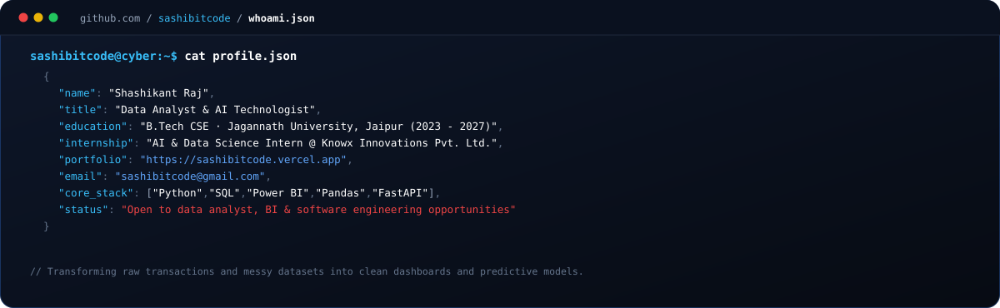

 

<!-- ================= TOOLBOX ================= -->
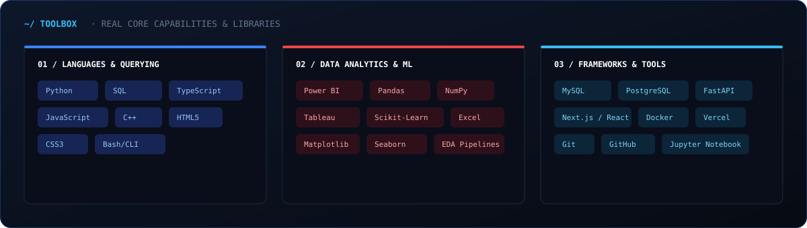

 

<!-- ================= 03 SELECTED WORK (4 REAL PRODUCTION REPOSITORIES) ================= -->
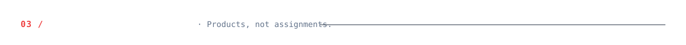

<a href="https://github.com/sashibitcode/sas-ai">
  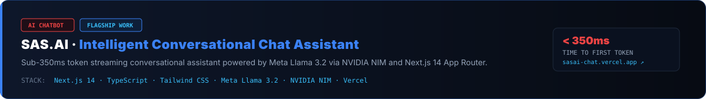
</a>

<a href="https://github.com/sashibitcode/quickdownload">
  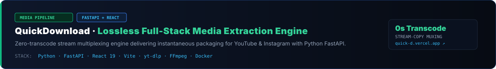
</a>

<a href="https://github.com/sashibitcode/Ecommerce-Sales-Analysis">
  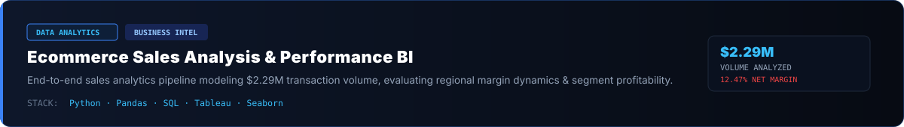
</a>

<a href="https://github.com/sashibitcode/IPL-Cricket-Analysis">
  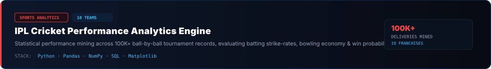
</a>

 

<!-- ================= GITHUB ANALYTICS ================= -->

 

<!-- ================= CONTRIBUTION SNAKE ================= -->
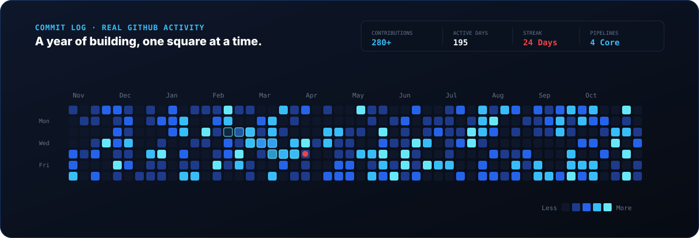

 

<!-- ================= CERTIFICATIONS (4 VERIFIED CREDENTIALS) ================= -->
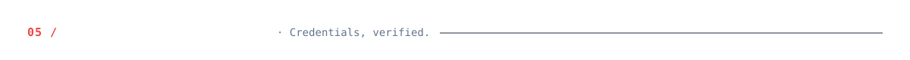

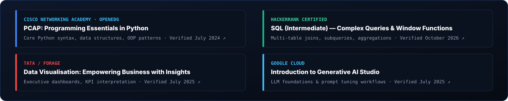

 

<!-- ================= UNIFIED FOOTER ================= -->

  
  
  
  
  

