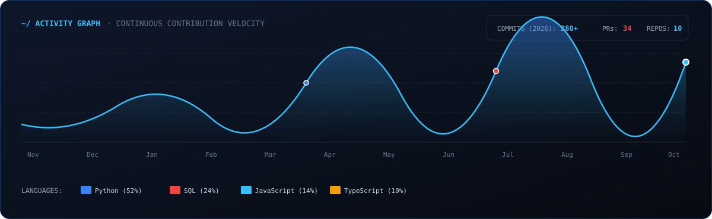

<div align="center">

<a href="https://sashibitcode.vercel.app">
  
</a>

<p align="center">
  <a href="https://sashibitcode.vercel.app"></a>
  <a href="https://github.com/sashibitcode"></a>
  <a href="https://www.linkedin.com/in/sashikant-raj/"></a>
  <a href="https://leetcode.com/u/sashibitcode/"></a>
  <a href="mailto:sashibitcode@gmail.com"></a>
</p>

</div>

<br>

### 💻 `~/ whoami`

```bash
$ cat about.txt
```

Hi, I'm **Shashikant Raj**. I build things that sit somewhere between data analytics and full-stack AI, and I solve problems when neither of those is cooperating.

- 🔭 Currently building [**sas-ai**](https://github.com/sashibitcode/sas-ai) and [**quickdownload**](https://github.com/sashibitcode/quickdownload)
- 🌐 Portfolio: [**sashibitcode.vercel.app**](https://sashibitcode.vercel.app)
- 🛠️ Core Stack: `Python` · `SQL` · `Power BI` · `Pandas` · `FastAPI` · `Next.js / React`
- 🎓 Education: **B.Tech Computer Science & Engineering** @ Jagannath University, Jaipur
- 💡 Fun fact: *I started coding seriously because I wanted to build things I wished existed.*

<br>

<div align="center">

### 🛠️ `~/ toolbox`

<p align="center">
  
</p>
<p align="center">
  
</p>

</div>

<br>

### 🚀 `03 Selected Work`

| Project | Description | Core Stack | Repository |
| :--- | :--- | :--- | :--- |
| **SAS.AI** | Full-Stack AI Chatbot with Meta Llama 3.2 via NVIDIA NIM (<350ms TTFT) | `Next.js 14` `TypeScript` `Tailwind` | [sashibitcode/sas-ai →](https://github.com/sashibitcode/sas-ai) |
| **QuickDownload** | Lossless Media Extraction Engine supporting YouTube, Instagram, X | `FastAPI` `Python` `React 19` | [sashibitcode/quickdownload →](https://github.com/sashibitcode/quickdownload) |
| **Ecommerce Sales Analysis** | $2.29M sales volume analytics dashboard with customer retention KPIs | `Power BI` `Python` `Pandas` | [Ecommerce-Sales-Analysis →](https://github.com/sashibitcode/Ecommerce-Sales-Analysis) |
| **IPL Cricket Performance** | Ball-by-ball match analytics across 10 teams and 100K+ records | `SQL` `Python` `Pandas` | [IPL-Cricket-Analysis →](https://github.com/sashibitcode/IPL-Cricket-Analysis) |

<br>

### 📈 `04 GitHub Analytics`



<br>

### 📜 `05 Certifications`

- 🏅 **PCAP: Programming Essentials in Python** — *Cisco Networking Academy*
- 🏅 **SQL (Intermediate) Certificate** — *HackerRank*
- 🏅 **Data Visualisation: Empowering Business with Effective Insights** — *Tata / Forage*
- 🏅 **Generative AI Studio on Google Cloud** — *Google Cloud Skills Boost*

<br>

<div align="center">

### 🌐 Let's Connect

<p align="center">
  <a href="https://www.linkedin.com/in/sashikant-raj/" target="_blank">
    
  </a>
  <a href="https://github.com/sashibitcode" target="_blank">
    
  </a>
  <a href="https://leetcode.com/u/sashibitcode/" target="_blank">
    
  </a>
  <a href="https://sashibitcode.vercel.app" target="_blank">
    
  </a>
  <a href="mailto:sashibitcode@gmail.com">
    
  </a>
</p>

</div>


